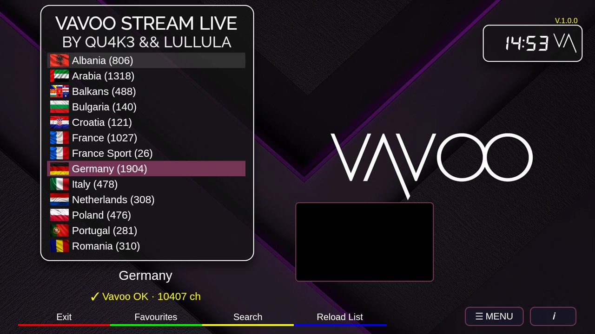
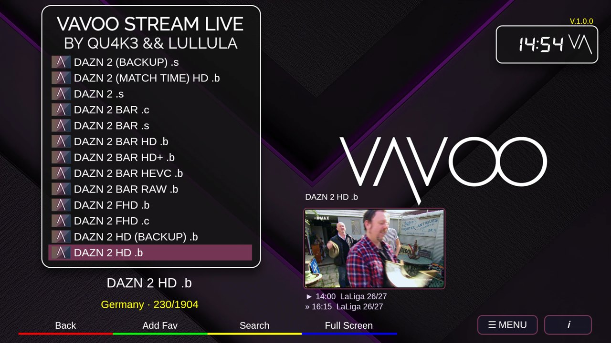
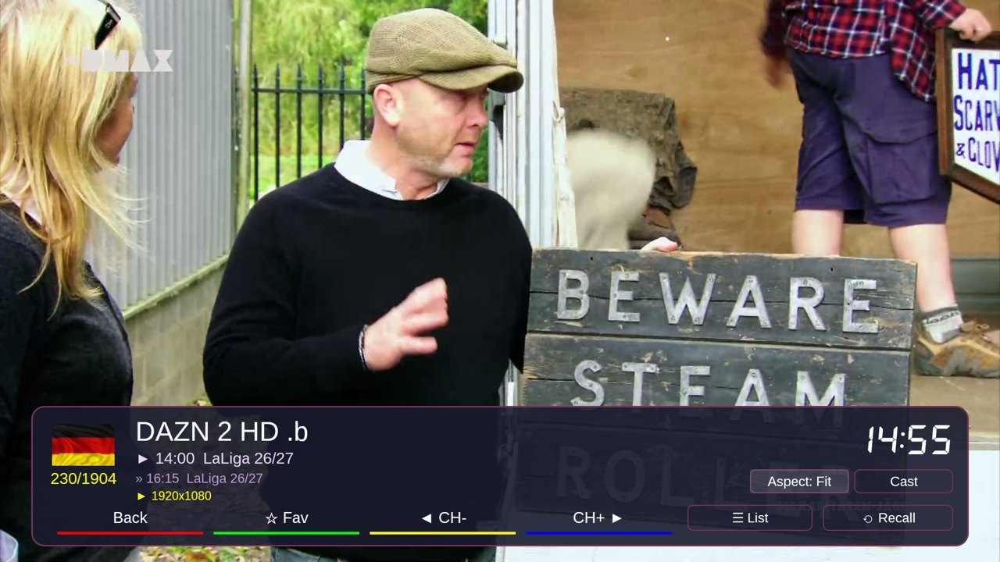
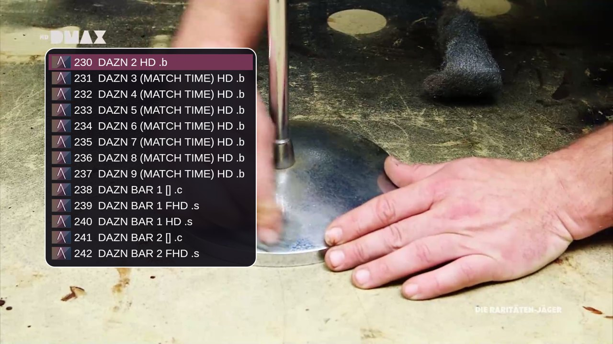
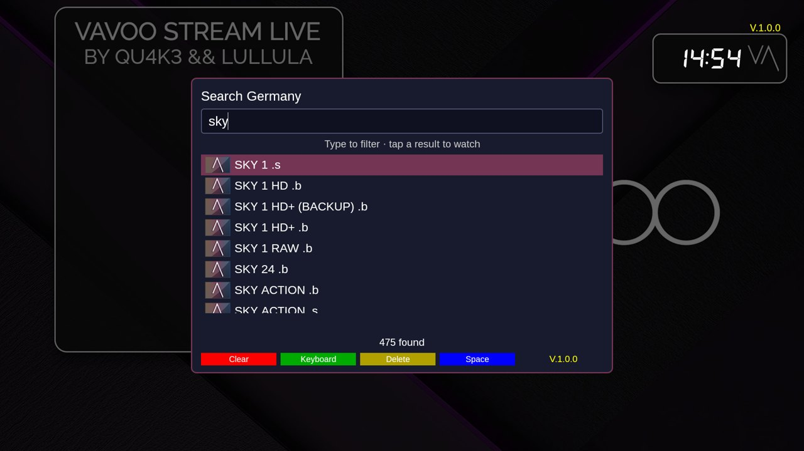
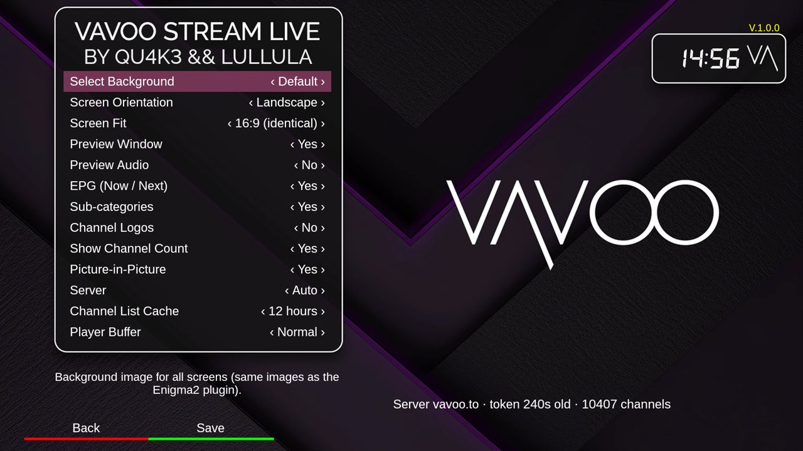
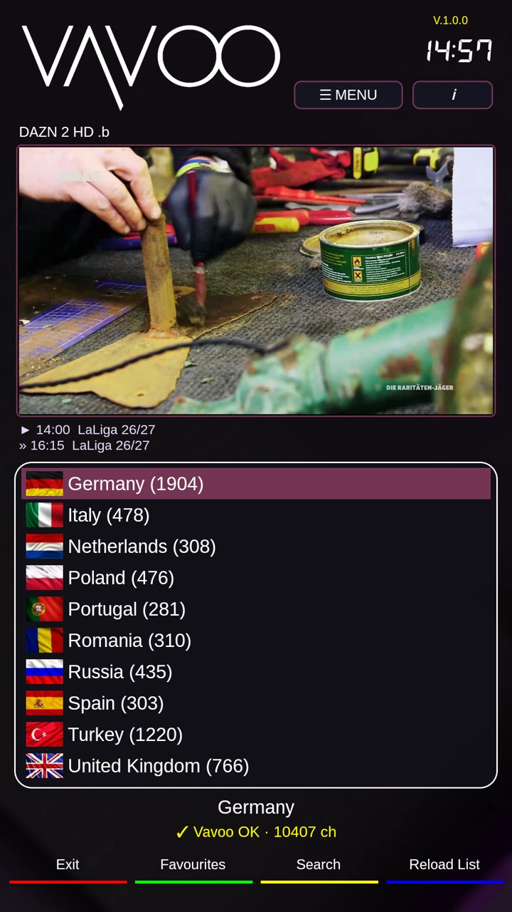
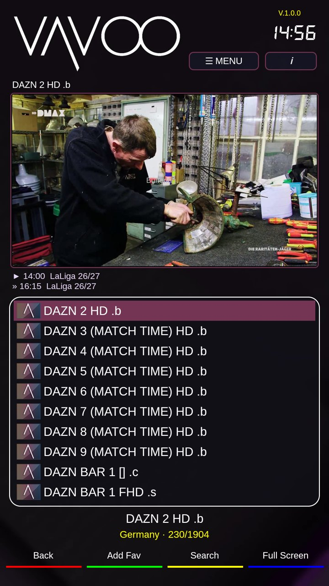

# Vavoo Stream Live – Android

**Android app by Qu4k3** (credited in the app as *by Qu4k3 && Lullula*).

Watch Vavoo / Kool.to live TV on your Android phone, tablet or Android TV box, with the
same look as the Enigma2 plugin *Vavoo Stream Live* it is based on.

## Download

**[⬇ Download the latest VavooStream.apk](https://github.com/OwnerPlugins/vavoo_android-releases/releases/latest)**

1. Open the latest release and download `VavooStream.apk`.
2. Open the file on your device and allow "install unknown apps" for your browser or file manager.
3. Android 5.0 or newer. Works with touch and with TV remotes (D-pad and colour keys).

The app checks this page for new versions and offers the update itself.
You can also follow releases automatically with [Obtainium](https://github.com/ImranR98/Obtainium):
add `https://github.com/OwnerPlugins/vavoo_android-releases`.

## Screenshots

| Countries | Channels with live preview and EPG |
| --- | --- |
|  |  |
| **Player infobar** | **Player channel list** |
|  |  |
| **Search** | **Settings** |
|  |  |

Portrait mode:

  
  &nbsp;
  

## Features

- Same screens as the Enigma2 plugin: countries with flags, channels, search, settings.
- Live preview window, EPG now/next, sub-categories, favourites.
- Full-screen player with infobar, channel list, recall, number keys, aspect ratio,
  picture-in-picture and Chromecast.
- Landscape (identical to the plugin) or portrait layout.
- 16 languages, following the phone's language.

## Problems?

In the app: **Settings → Show Log → Share**, and send the log with a short description.

## Credits & license

- Android app: **Qu4k3**.
- Based on the Enigma2 plugin *Vavoo Stream Live* by **Lululla / Belfagor2005**.
- License: [CC BY-NC-SA 4.0](https://creativecommons.org/licenses/by-nc-sa/4.0/) –
  non-commercial, attribution required, share-alike.
